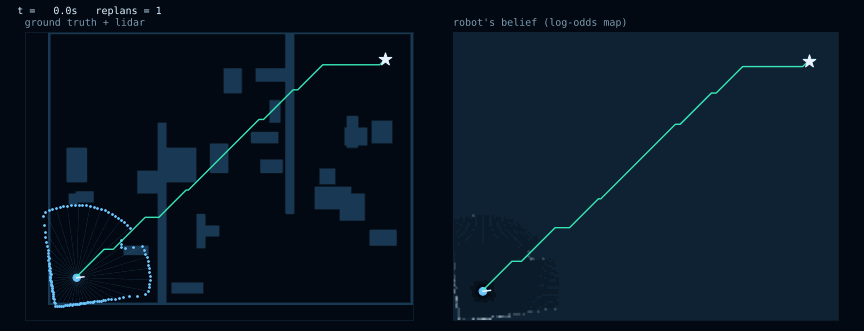

# autonomy-sim

**A mobile robot that drives into a map it has never seen, builds the map from LiDAR as it goes, and replans every time reality disagrees with its belief.**



*Left: the ground truth and live LiDAR returns. Right: what the robot actually knows (a log-odds occupancy grid). Blue: current A\* plan. White: driven path.*

---

## The loop

```
 ┌──────── sense ────────┐   ┌──────── map ────────┐   ┌──────── plan ────────┐   ┌──────── act ────────┐
 │ 120-beam 2D LiDAR     │ → │ log-odds occupancy  │ → │ A* on an inflated    │ → │ pure pursuit on a   │
 │ ray-marched, σ=3cm    │   │ grid (Bayes update) │   │ 8-connected grid     │   │ unicycle model      │
 └───────────────────────┘   └─────────────────────┘   └──────────────────────┘   └─────────────────────┘
                                         ▲                       │
                                         └── replan if a newly ──┘
                                             seen obstacle cuts the path
```

| module | what it does | the idea behind it |
|---|---|---|
| `lidar.py` | Casts N rays and returns noisy ranges | Vectorised ray marching. Beams with no return report exactly `max_range`, so the mapper never turns sensor noise into a phantom wall. |
| `mapping.py` | Fuses scans into a belief map | Each cell stores log-odds `l = log(p/(1-p))`. A Bayes update is just addition: `+0.85` where a beam ends, `-0.4` along the beam. Clamped to ±4 so the map can still change its mind. |
| `planner.py` | A* from robot to goal | Octile heuristic (admissible and consistent on an 8-grid, so the first goal pop is optimal). No corner cutting. Obstacles are inflated by the robot radius so the robot can be planned as a point. |
| `control.py` | Turns a path into `(v, ω)` | Pure pursuit: curvature `κ = 2·y_L / L²` to a lookahead point. Slows on sharp turns and turns in place if the target is behind it. |
| `sim.py` | Runs the sense→map→plan→act loop | **Optimistic planning:** unknown space counts as free. The robot commits to a plan, then replans only when the map shows the plan is blocked. |

## Results (seed 7)

```
reached goal   : True
sim time       : 44.2 s
distance       : 68.2 m  (1.64x straight-line)
replans        : 36
A* median time : 2.5 ms
```

Reaches the goal on every seed from 9 to 12 as well. Seed 8 is unreachable by construction (clutter seals the gap), and the planner correctly reports no path.

## Run it

```bash
pip install -r requirements.txt
python run.py                      # metrics
python run.py --gif media/demo.gif # render the animation
python -m pytest -q                # 7 tests: A* optimality, walls, unreachable goals, LiDAR range, end-to-end
```

## What's next

- [ ] **Localization:** remove the known-pose assumption, add odometry drift and a particle filter (that makes it full SLAM)
- [ ] **D\* Lite:** incremental replanning instead of planning from scratch
- [ ] **Frontier exploration:** map the whole space with no goal given
- [ ] **ROS 2 port:** same nodes on real topics, then onto a physical differential-drive robot

---

Built by [Sandeep Sah](https://github.com/sunnyssah7), EE @ UC Riverside. Part of a series of builds toward edge AI and robotics.
